Help the user understand the current topic of conversation visually. Skip the preamble and keep prose brief. Pick the smallest view that makes the key point clear.

## Code shapes

- Show straight-line logic as pseudocode. Mark what matters with `◀` notes:

```text
on(save)
  if content is unchanged
    return cached result
  write new content          ◀ side effect: disk
  invalidate cache           ◀ async, not awaited
  return fresh result
```

- Show runtime control flow as a call tree:

```text
submitForm
  createSession
    persistPrompt
    launchAgent
  navigateToSession
```

- Show UI structure as a component tree, including state and module boundaries that matter:

```tsx
<SessionPage> (apps/example/src/routes/session.tsx)
  useSessionEvents()
  <SessionToolbar>
    <RunSkillButton> (packages/ui)
```

- Show file responsibility or a broad refactor as a shallow file tree:

```text
src/
├── commands/       # parses user actions
├── sessions/       # owns session state
└── transport/      # sends API requests
```

## Diagrams

Draw every diagram as a Mermaid block. Never draw boxes, arrows, or flows by hand with text characters. Label nodes and arrows with real names from the code.

- Show architecture as a flowchart. Group nodes into subgraphs by package or module so ownership is visible:

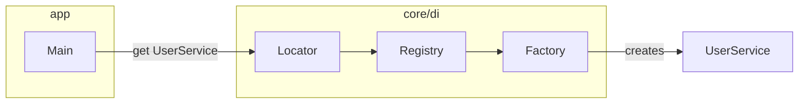

- Show classes with a class diagram. Include only the key fields, methods, and relationships:

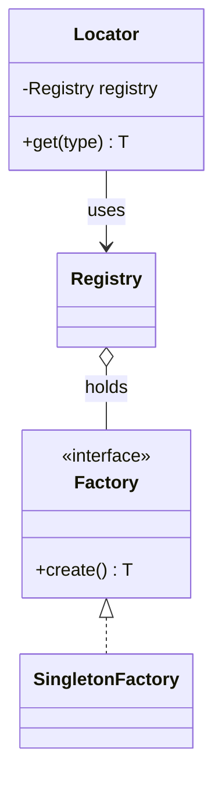

- Show interactions between components as a sequence diagram with `autonumber`, so the text can refer to steps:

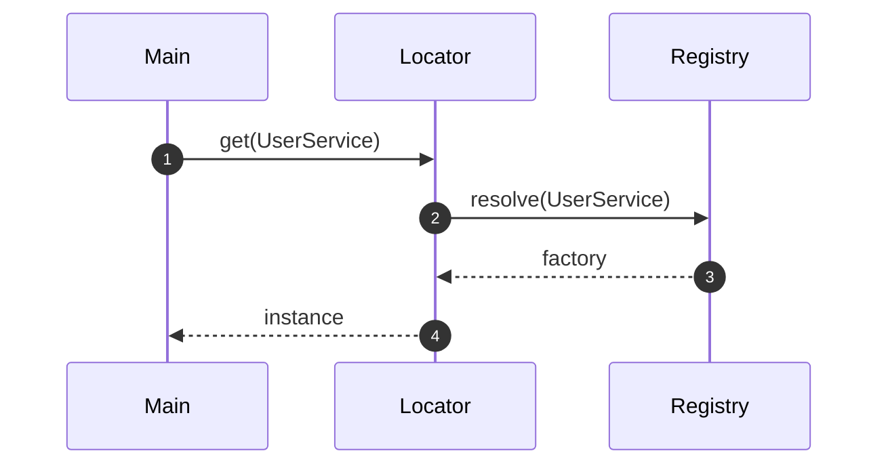

- Show lifecycles and state machines as a state diagram, and data models as an ER diagram:

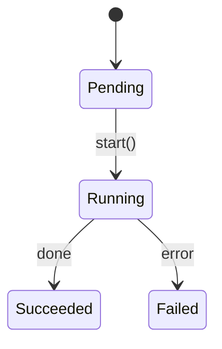

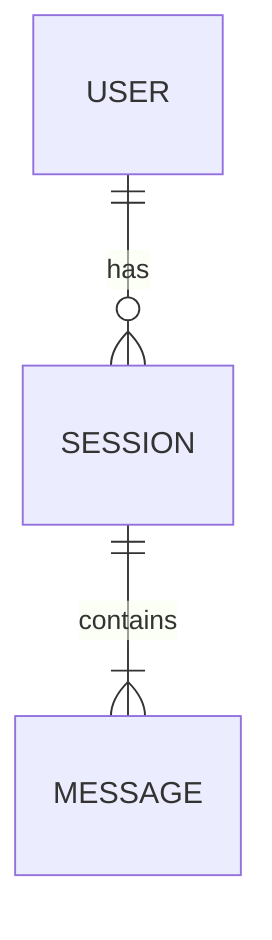

- Show logic with branches as a decision flowchart. Color the happy path and the edge cases differently when edge cases matter:

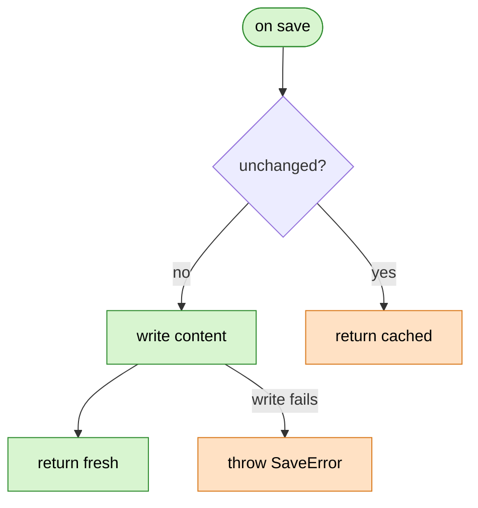

- When the user needs both the exact logic and the picture, number the pseudocode steps (①②③) and use the same numbers in the flowchart nodes. Use this sparingly.

### Styling

- Highlight the thing the user asked about and mute the rest:

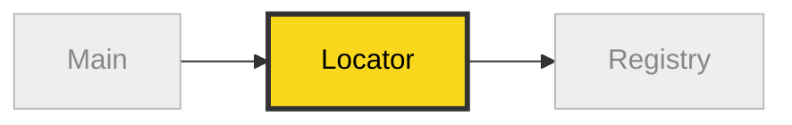

- Use the same color for each layer in every diagram, and add a legend when the colors aren't obvious:

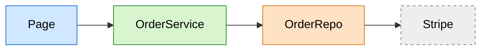

### Loops

- By default, put the loop body in a subgraph with a dashed "next" arrow back to the start:

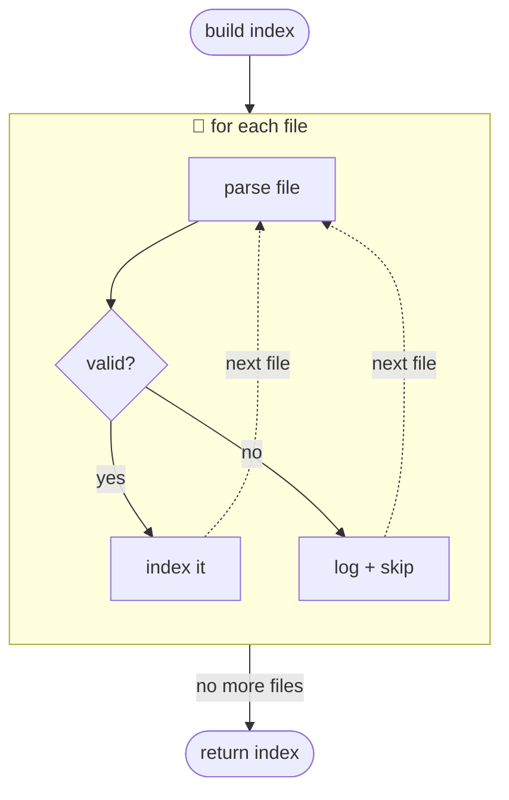

- Show nested loops as nested subgraphs:

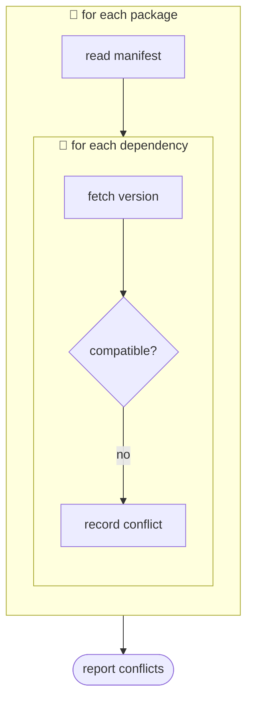

- When the loop is about calls between components, use a `loop` block in a sequence diagram:

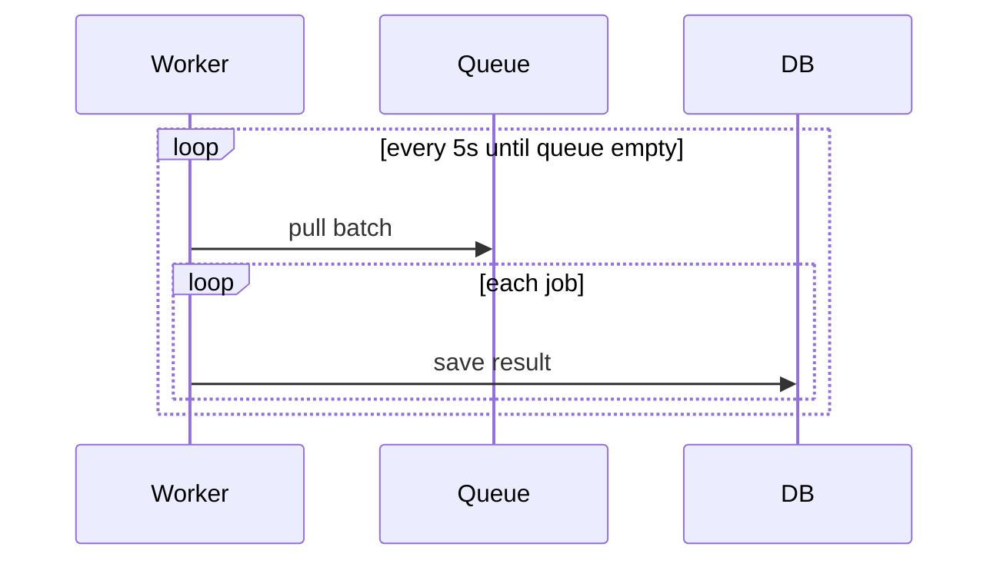

- Show retries and polling as a state diagram, with the attempt count and backoff on the arrows:

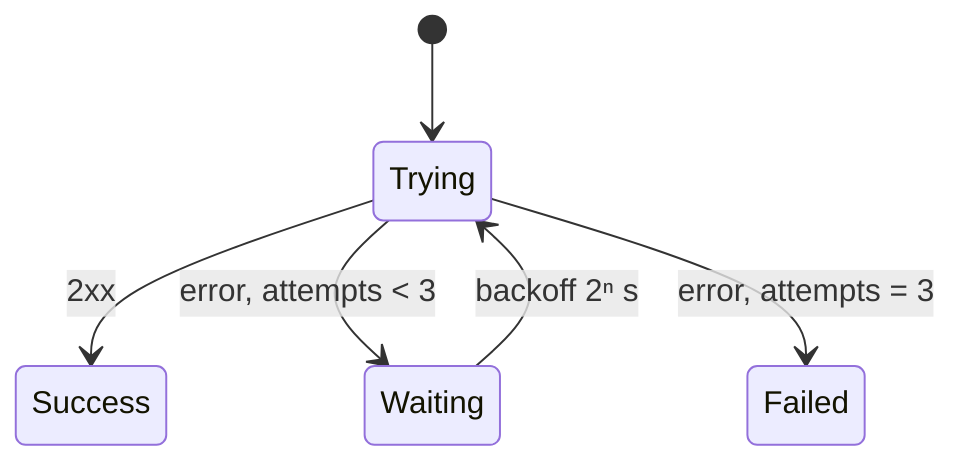

- When the exits are the interesting part, color the exit nodes:

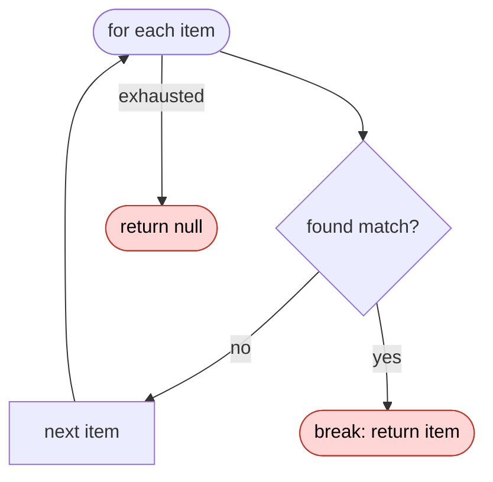

## Diffs

Use `diff` when the point is what changes and the surrounding shape already exists.

- For a code change, start with the file path. Above the method, show the call stack within the same file with line numbers, and mark the changed method. Leave the call stack out if nothing else in the file calls it. Use `⋮` for skipped lines:

```diff
@@ src/cache/store.ts @@
# call stack in this file:
#   update()            :12
#   └─ commit()         :27
#      └─ save()        :42   ◀ changed
#   restore()           :60
#   └─ save()           :42   ◀ changed
 export function save(key: string, value: string) {
-  db.write(key, value)
+  if (cache.get(key) === value) return
+  db.write(key, value)
+  cache.set(key, value)
 }
⋮
```

- For a file-layout change:

```diff
 src/
 ├── commands/
+│   └── visualize.ts      # expands the slash command
 ├── sessions/
-└── transport.ts
+└── transport/
+    ├── client.ts
+    └── stream.ts
```

- For a call-tree change, draw the new tree and color what was added or removed:

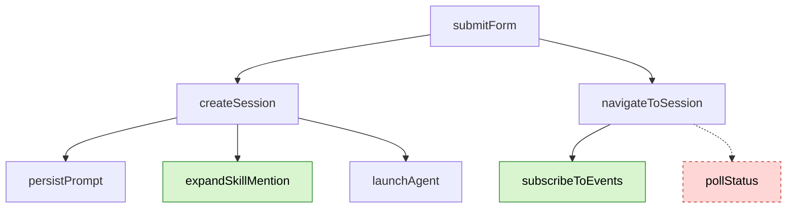

- Show the whole block when most of it is new, when omitted context would hide ownership or order, or when the user needs a copyable target shape:

```ts
function expandSkill(command: string): string {
  const skillName = command.slice(1)
  return `use the ${skillName} skill`
}
```

## Guidance

- Use visuals as the main way to explain. Text comes second.
- Below each visual, write a short description of what it shows.
- Before presenting, re-read the visuals and descriptions. Check that they answer what the user asked. If they don't, rework them until they do.
